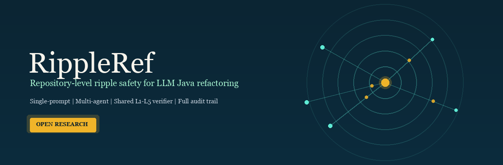
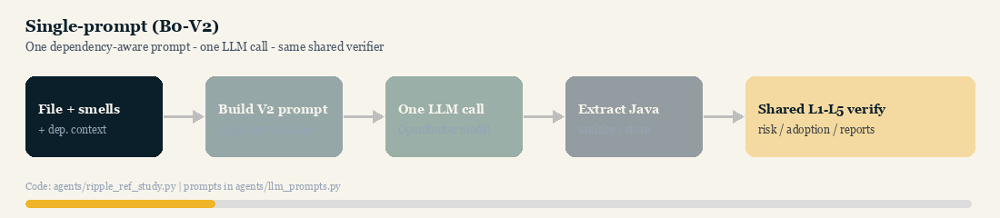
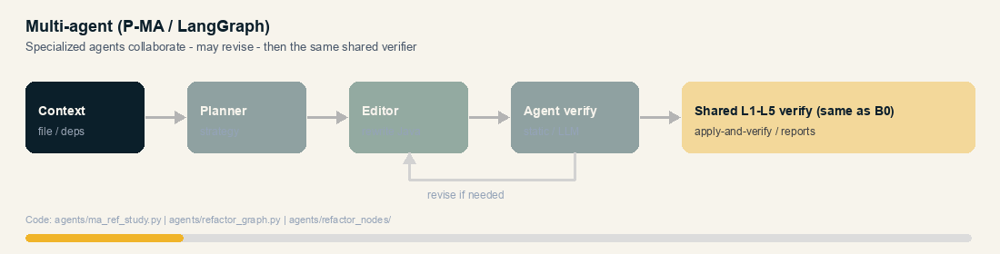
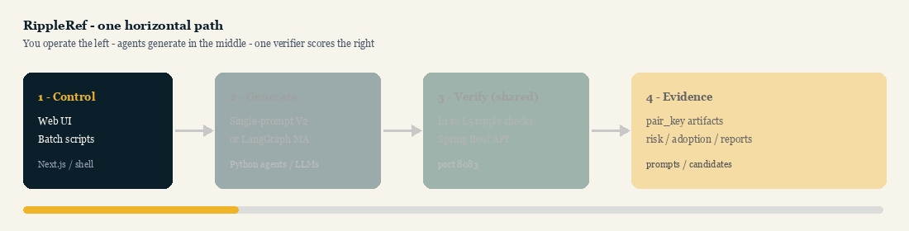

<p align="center">
  
</p>

<p align="center">
  <strong>Most LLM refactoring demos stop at the edited file.<br/>RippleRef asks what broke downstream.</strong>
</p>

<p align="center">
  <a href="LICENSE"></a>
  <a href="wiki/Home.md"></a>
  
  
  
  
</p>

<p align="center">
  <a href="#why-rippleref-exists">Why</a> ·
  <a href="#what-makes-it-different">Innovation</a> ·
  <a href="#how-generation-works-two-modes">Single-prompt vs MA</a> ·
  <a href="#architecture">Architecture</a> ·
  <a href="#quick-start">Quick start</a> ·
  <a href="#study-arms">Study arms</a> ·
  <a href="wiki/Home.md">Wiki</a> ·
  <a href="#citation">Cite</a>
</p>

---

## Why RippleRef exists

A “successful” LLM rewrite of `Foo.java` can still:

- remove a **caller-used** API  
- shift **inheritance / package / constructors**  
- compile locally while **breaking dependents**  
- look complete in Markdown while the Java body is **truncated at the token cap**

RippleRef is a **full-stack research platform** (Web UI + Spring API + Python agents + batch scripts) for measuring that **ripple**: dependency-aware generation, then a shared **L1–L5** verification trail for every candidate.

> This is a **code replication package**. It ships the system you run experiments *with* — not canned Excel result tables.

**Public repo:** [ResearchAnonymized/RippleRef](https://github.com/ResearchAnonymized/RippleRef)

---

## What makes it different

<table>
<tr>
<td width="50%" valign="top">

### 1. Dependency-aware generation
Single-prompt **V2** embeds a **dependency context package** (callers, APIs, structure) — not just “here is a file, please clean it.”

### 2. Two agentic regimes, one truth
**B0** = one-shot LLM rewrite · **P-MA** = LangGraph plan → edit → verify loop.  
Both land on the **same** apply-and-verify pipeline so comparisons stay scientific.

</td>
<td width="50%" valign="top">

### 3. L1–L5 ripple protocol
Profiles → caller impact → compile probe → contract/dependency signals → behavioral/tests when eligible. Risk and adoption labels leave an **audit trail**, not a vibe score.

### 4. Built for cohorts, not demos
Study IDs, pair keys, artifact folders, overnight scripts — designed for **hundreds of (project, file, model)** runs with reproducible configuration.

</td>
</tr>
</table>

---

## How generation works (two modes)

Both modes start from the **same dependency context** and finish on the **same L1–L5 verifier**. Only the middle differs.

### Prompt-based — Single-prompt V2 (B0)

One packaged prompt → **one** LLM completion → extract Java → verify. *(animated)*

<p align="center">
  
</p>

### Multi-agent — LangGraph (P-MA)

Planner → Editor → agent-side checks → optional revise loop → **same** shared verify. *(animated — watch the revise loop)*

<p align="center">
  
</p>

| | Single-prompt V2 | Multi-agent MA |
|--|------------------|----------------|
| LLM calls | Typically **one** | **Several** (plan / edit / verify) |
| Dependency context | Embedded in the V2 prompt | Available to the agent graph |
| Revision | No internal loop | Can revise before final verify |
| Final scoring | Shared L1–L5 | Shared L1–L5 |

More detail: [`wiki/Agentic-Systems.md`](wiki/Agentic-Systems.md).

---

## Repository map

| Layer | Path | You use it to… |
|------|------|----------------|
| **Web UI** | [`web/app/`](web/app/) | Drive **RIPPLE-REF Study** & **Multi-Agent Study** from the dashboard |
| **API** | [`backend/`](backend/) | Scan repos, select files, build contexts, apply-and-verify, store artifacts |
| **Agents** | [`agents/`](agents/) | Run B0 (`ripple_ref_study.py`) and MA (`ma_ref_study.py` + `refactor_graph.py`) |
| **Scripts** | [`scripts/`](scripts/) | Overnight batches, preflight, pipeline helpers |
| **Wiki** | [`wiki/`](wiki/Home.md) | Setup, architecture diagrams, protocol, replication playbook |
| **Deep docs** | [`docs/`](docs/) | Integrity rules + technical setup |

---

## Architecture

<p align="center">
  
</p>

| Stage | What happens |
|-------|----------------|
| **1 · Control** | Researcher uses the **Web UI** or **scripts** |
| **2 · Generate** | **Single-prompt V2** *or* **LangGraph MA** produces a candidate |
| **3 · Verify** | **Same** Spring API path runs **L1–L5** ripple checks |
| **4 · Evidence** | Artifacts stored under `pair_key` with risk / adoption labels |

```text
pair_key = project_id | file_path | model_id | variant
```

Deeper detail: [`wiki/Architecture.md`](wiki/Architecture.md).
---

## Quick start

### Requirements

Java **17+** · Maven **3.8+** · Node.js **18+** · Python **3.10+** · OpenRouter (or compatible) API key

### 1 — Secrets

```bash
cp agents/.env.example agents/.env
# set OPENROUTER_API_KEY and pin model slugs
```

### 2 — API (port **8083**)

```bash
cd backend
mvn -pl server -am package -DskipTests
# run ai.refact.server.RefactAIServerApplication
```

### 3 — Agents

```bash
cd agents
python3 -m venv .venv && source .venv/bin/activate
pip install -r requirements.txt
./start.sh
```

### 4 — Web UI

```bash
cd web/app
npm install
npm run dev
# → http://localhost:3001  →  RIPPLE-REF Study / Multi-Agent Study
```

Step-by-step troubleshooting: [`wiki/Setup.md`](wiki/Setup.md).

> Full cohort overnight runs are **long and billable**. Start with a one-file smoke test ([`wiki/Replication-Guide.md`](wiki/Replication-Guide.md)).

---

## Study arms

| Paper term | Study ID | Variant | Generation |
|------------|----------|---------|------------|
| Single-prompt (dependency-aware) | `ripple_ref_master` | `V2` | One LLM call + dependency context |
| Single-prompt ablation | `ripple_ref_master` | `V1` | Ablation prompt packaging |
| Multi-agent | `ma_ref_master` | `MA` | LangGraph plan / edit / verify |

Primary scientific contrast: **P-MA vs B0-V2** on matched `(project, file, model)` pairs — same verifier.

Integrity: [`docs/RIPPLE_REF_RESEARCH_INTEGRITY.md`](docs/RIPPLE_REF_RESEARCH_INTEGRITY.md) · [`docs/MA_RESEARCH_INTEGRITY.md`](docs/MA_RESEARCH_INTEGRITY.md)

---

## Wiki

| Start here | Then |
|------------|------|
| [Home](wiki/Home.md) | [Setup](wiki/Setup.md) |
| [Architecture](wiki/Architecture.md) | [Agentic systems](wiki/Agentic-Systems.md) |
| [Experiment protocol](wiki/Experiment-Protocol.md) | [Replication guide](wiki/Replication-Guide.md) |

---

## Design stance

| We optimize for | We refuse to fake |
|-----------------|-------------------|
| Traceable candidates | “It compiled in the chat window” |
| Matched SP vs MA protocols | Silent protocol drift mid-study |
| Explicit token / model pins | Undocumented provider defaults |
| Open code others can rerun | Shipping private Excel as “the science” |

**Not in this repo:** result workbooks, API keys, `node_modules` / `.venv`, ICSE/REFINE smell-product trees, raw multi-GB study dumps.

---

## Citation

```bibtex
@software{RippleRef,
  title        = {RippleRef: Repository-level ripple safety for LLM-generated Java refactoring},
  author       = {{Research Anonymized}},
  year         = {2026},
  url          = {https://github.com/ResearchAnonymized/RippleRef},
  license      = {MIT}
}
```

Update [`CITATION.cff`](CITATION.cff) when the paper DOI is available.

---

## License

[MIT](LICENSE) — open research use welcome. Fork it, instrument it, break it on *your* corpus — then measure the ripples.
