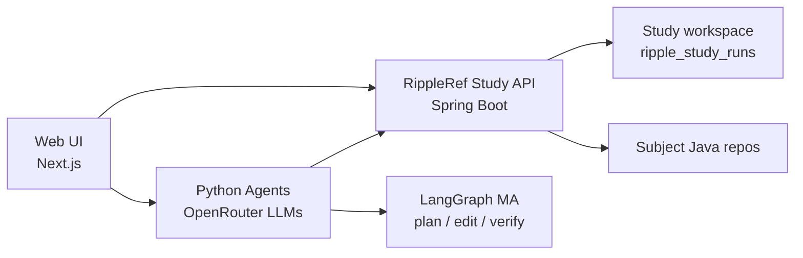
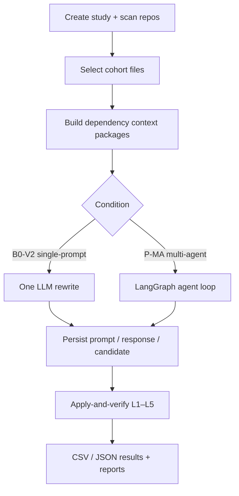

# RippleREF

**Repository-level ripple safety for LLM-generated Java refactoring**

RippleREF is an open research platform for running **dependency-aware single-prompt** and **multi-agent (LangGraph)** Java refactoring experiments, then verifying candidates with a layered **L1–L5** ripple protocol (profiles, caller impact, compile/test probes, adoption/risk labels).

This repository is a **clean replication package**: Web UI, REST API, Python agents, and run scripts. It does **not** ship study Excel result workbooks. Anyone with API access can re-run a similar experiment on their own cohort.

Public repository: [`ResearchAnonymized/RippleRef`](https://github.com/ResearchAnonymized/RippleRef).

---

## What you get

| Layer | Path | Role |
|-------|------|------|
| Web UI | `web/app/` | Next.js dashboard — **RIPPLE-REF Study** and **Multi-Agent Study** panels |
| API | `backend/` | Spring Boot server — cohort scan/select, dependency context, apply-and-verify, artifacts |
| Agents | `agents/` | Single-prompt (`ripple_ref_study.py`) and multi-agent (`ma_ref_study.py`, `refactor_graph.py`) |
| Scripts | `scripts/` | Overnight runners, export helpers, cohort bootstrap, MA/RIPPLE pipelines |
| Docs | `docs/`, `wiki/` | Integrity rules, technical setup, architecture wiki + diagrams |

---

## Architecture (overview)



Study workflow:



More diagrams: [`wiki/Architecture.md`](wiki/Architecture.md).

---

## Requirements

- **Java 17+**, **Maven 3.8+**
- **Node.js 18+** (Web UI)
- **Python 3.10+** (agents)
- **OpenRouter API key** (or compatible OpenAI-style endpoint)
- Disk space for cloned subject repositories and study artifacts under `~/.refactai/`

---

## Quick start

### 1. Configure secrets (never commit)

```bash
cp agents/.env.example agents/.env
# Edit agents/.env — set OPENROUTER_API_KEY and model IDs
```

### 2. Backend API

```bash
cd backend
mvn -pl server -am package -DskipTests
# Run the Spring Boot server (see wiki/Setup.md for the exact main class / port)
```

Default API port is **8083** (`backend/server/src/main/resources/application.yml`).

### 3. Python agents

```bash
cd agents
python3 -m venv .venv
source .venv/bin/activate
pip install -r requirements.txt
./start.sh   # or: python main.py
```

### 4. Web UI

```bash
cd web/app
npm install
npm run dev
# open http://localhost:3001 — use RIPPLE-REF Study / Multi-Agent Study
```

### 5. Scripted study runs (optional)

See `scripts/run-ripple-ref-master-overnight.sh`, `scripts/run-ma-ref-master-overnight.sh`, and `scripts/ripple-ref-lib.sh`. Read flags before launching — full cohort runs are **long and billable** (LLM tokens).

---

## Experiment conditions (paper terms)

| Paper term | Study ID | Variant |
|------------|----------|---------|
| Single-prompt (dependency-aware) | `ripple_ref_master` | `V2` |
| Single-prompt ablation | `ripple_ref_master` | `V1` |
| Multi-agent | `ma_ref_master` | `MA` |

Verification uses the shared ripple path (regex profiles, caller checks, compile/test probes). Details: [`docs/RIPPLE_REF_RESEARCH_INTEGRITY.md`](docs/RIPPLE_REF_RESEARCH_INTEGRITY.md), [`docs/MA_RESEARCH_INTEGRITY.md`](docs/MA_RESEARCH_INTEGRITY.md).

---

## Wiki

| Page | Content |
|------|---------|
| [`wiki/Home.md`](wiki/Home.md) | Start here |
| [`wiki/Setup.md`](wiki/Setup.md) | Install & run |
| [`wiki/Architecture.md`](wiki/Architecture.md) | System + MA diagrams |
| [`wiki/Experiment-Protocol.md`](wiki/Experiment-Protocol.md) | Cohort, models, L1–L5 |
| [`wiki/Agentic-Systems.md`](wiki/Agentic-Systems.md) | Single-prompt vs LangGraph MA |
| [`wiki/Replication-Guide.md`](wiki/Replication-Guide.md) | How to replicate a similar study |

---

## What is intentionally not included

- Study **Excel / CSV result dumps** (analysis workbooks)
- API keys and `.env` files
- `node_modules/`, Python `.venv/`, Maven `target/`
- ICSE / REFINE smell-effectiveness product tree
- Full historical `~/.refactai/workspaces/ripple_study_runs/` artifact stores

---

## Citation

If you use RippleREF in academic work, cite the associated paper (update `CITATION.cff` when the venue/DOI is final) and this software repository.

---

## License

See [`LICENSE`](LICENSE). Derived from the RefactAI research codebase; packaging focuses on the RippleREF / MA-REF experimental surface.

---

## Pushing to GitHub (when ready)

```bash
cd /Users/svm648/refactai/RippleREF
git init
git add .
git commit -m "Initial RippleREF replication package (UI, API, agents, scripts, wiki)"
git branch -M main
git remote add origin https://github.com/ResearchAnonymized/RippleRef.git
git push -u origin main
```
