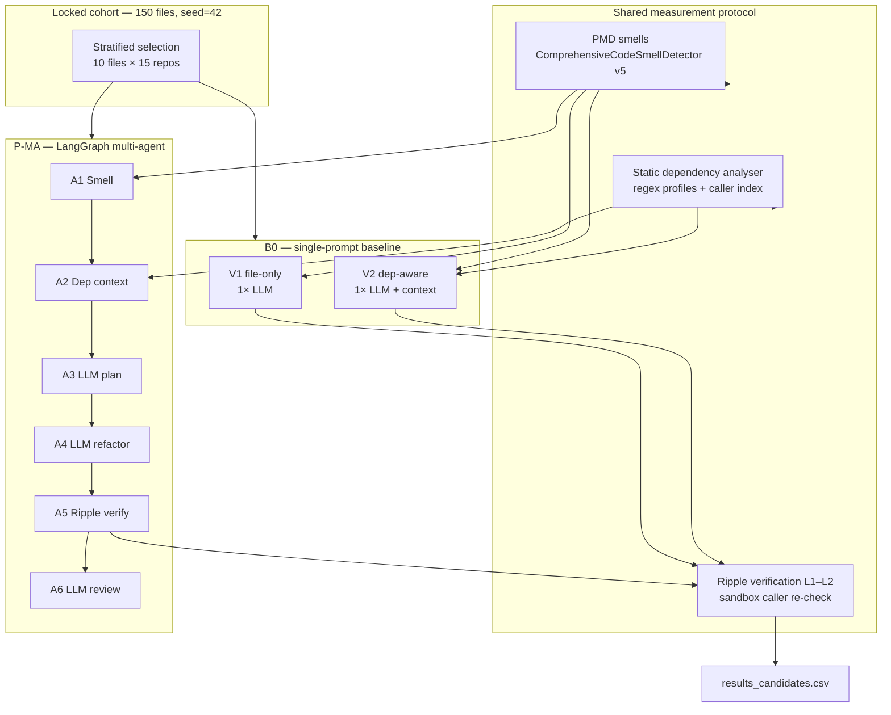

# TSE Paper — Experimental Setting (authoritative draft)

> **Package:** `TSE/` (IEEE TSE venue). Source snapshot of `wiki/EMSE_Experimental_Setting.md`.

**Paper type:** Empirical study — controlled comparison of refactoring orchestration under ripple-risk measurement  
**Studies:** `ripple_ref_master` (B0 baseline) + `ma_ref_master` (P-MA primary, planned)  
**Draft date:** 2026-07-04  
**Use:** Copy/adapt into LaTeX §Experimental Setting / §Methodology

---

## 1. Study objective

We evaluate whether **LangGraph-based multi-agent orchestration** reduces **ripple-effect risks** in AI-assisted Java refactoring compared with **dependency-aware single-prompt** refactoring, while holding constant the measurement protocol (smell detection, dependency extraction, ripple verification) and the stratified file cohort.

---

## 2. Research questions (locked)

| RQ | Question |
|----|----------|
| **RQ1** | What dependency and contract exposure do the selected Java files have before AI refactoring? |
| **RQ2** | What ripple-effect risks are introduced by dependency-aware single-prompt AI refactoring? |
| **RQ3** | Does LangGraph-based multi-agent orchestration reduce ripple-effect risks compared with dependency-aware single-prompt refactoring? |
| **RQ4** | How do frontier models differ in ripple-risk behaviour across single-prompt and multi-agent refactoring? |
| **RQ5** | Which file, model, orchestration, and edit characteristics are associated with high ripple risk? |

---

## 3. Corpus and sampling

### 3.1 Repositories

**15 open-source Java systems** registered in study `ripple_ref_master`, including libraries, tools, and applications (e.g. JHotDraw, JUnit, Guava, ArgoUML, JabRef, Checkstyle).

### 3.2 Stratified file selection

| Parameter | Value |
|-----------|--------|
| Files per repository | **10** |
| Total file cohort | **150** |
| Random seed | **42** (per-repo seed offset: `seed + hash(workspaceId)`) |
| Minimum smells | ≥ 1 PMD smell |
| Stratification buckets | high fan-in, medium fan-in, low fan-in, high public API, high smell+dependency, random fill |

**Selection implementation:** `RippleRefFileSelector.stratifiedSample()`  
**Artifacts:** `selected_files.csv`, `sampling_group`, `selection_reason` per file

### 3.3 Locked cohort rule

After B0 completes, the **same 150 `(project_id, file_path)` pairs** are exported to `cohort_manifest.json` and reused for P-MA without re-sampling. This is required for paired RQ3 analysis.

---

## 4. Experimental conditions (independent variable)

| Condition | Study ID | Orchestration | Dependency context | LLM calls per candidate (typical) |
|-----------|----------|---------------|-------------------|--------------------------------|
| **B0-V1** | `ripple_ref_master` | Single-prompt | None (file + smells only) | 1 |
| **B0-V2** | `ripple_ref_master` | Single-prompt | Dependency context text in user prompt | 1 |
| **P-MA** | `ma_ref_master` | LangGraph multi-agent (`MULTI_LLM_AGENT_MODE=full`) | Same context via **Dependency Context Agent** (same backend data) | 3 LLM agents + static agents |

**Primary comparison (RQ3):** P-MA vs **B0-V2** on `(project_id, file_path, model_id)`.

**B0-V1 role:** Sensitivity / ablation (context in prompt only vs no context).

### 4.1 B0 single-prompt pipeline (baseline)

1. Load frozen file content  
2. **PMD smell detection** (backend)  
3. `prioritize_smells()` + rule plan text  
4. V2 only: inject `dependency_context` text  
5. **One** `chat_completion` (refactor)  
6. **Ripple verify** (`apply-and-verify`, L1–L2)  
7. Record `results_candidates.csv` row  

**Implementation:** `agents/ripple_ref_study.py` → `/agents/ripple-ref/run-candidate`

### 4.2 P-MA multi-agent pipeline (primary)

1. **A1** Code Smell Detector — same PMD path as B0  
2. **A2** Dependency Context Agent — **same** `RippleRefDependencyScanner` output as B0-V2  
3. **S2** Rule Planner — Fowler technique mapping  
4. **A3** LLM Planning Agent — JSON plan (no code)  
5. **S3** Size Advisor — token/LOC gate  
6. **A4** LLM Refactoring Agent — candidate Java  
7. **S4** Quality Verifier — static gates (`verification_gates.py`)  
8. **A5** Ripple Risk Verifier — **same** `apply-and-verify` as B0  
9. **A6** LLM Verification Agent — approve/reject with rationale  
10. **S5** Analysis Reporter — metrics + `agent_traces/`  

**Implementation:** LangGraph `refactor_graph.py` + study mode `MA_STUDY_MODE=ripple_cohort`

---

## 5. Measurement protocol (held constant)

### 5.1 Code smell identification

| Aspect | Specification |
|--------|----------------|
| **Tool** | PMD via `ComprehensiveCodeSmellDetector` |
| **Engine version** | `SMELL_ENGINE_VERSION = 5` (pinned in artefacts) |
| **B0 API** | `GET /workspaces/{id}/files/analysis?filePath=...` |
| **P-MA API** | **Same endpoint** in `MA_STUDY_MODE` (controlled experiment) |
| **Prioritization** | `prioritize_smells()` — same function both arms |
| **Before/after counts** | Same detector in `apply-and-verify` → `smell_before`, `smell_after` |

**Important:** Smells are **not** identified by the LLM or by the dependency scanner. PMD only.

### 5.2 Dependency and caller exposure (pre-refactor)

| Aspect | Specification |
|--------|----------------|
| **Tool** | Custom static analyser — **not PMD** |
| **Components** | `RippleRefDependencyScanner`, `RippleRefJavaProfileExtractor`, `DependencyAnalysisService` |
| **Method** | Regex extraction of packages, imports, public/protected APIs, extends/implements; file-level dependency graph; caller detection via class/method text matching (`ClassName.method(`) |
| **Outputs** | `fan_in`, `fan_out`, `caller_files`, `caller_used_apis`, `public_apis`, `dependency_context.json` |
| **B0-V2 use** | Serialized as prompt text (`dependency_contexts/*.txt`) |
| **P-MA use** | Same JSON/text via **A2 Dependency Context Agent** (wrapper, no duplicate logic) |

**Limitation (stated in paper):** No pointer analysis, no JDT/Spoon call graph. Reflection, DI frameworks, and name collisions may cause false positives/negatives. Mitigated by L2 caller re-check and manual audit (§7.3).

### 5.3 Ripple-effect outcome (post-refactor)

Five verification levels; **L1 and L2 are primary** for RQ2–RQ5.

| Level | Name | Mechanism |
|-------|------|-----------|
| **L1** | Contract risk | Static diff of before/after Java profiles on target file (APIs, signatures, imports, fan-out delta) |
| **L2** | Observed caller impact | Isolated sandbox: replace only target file; re-read pre-identified callers; count broken references to caller-used APIs |
| L3 | Compile probe | Optional `mvn compile` (best-effort; reported separately) |
| L4 | Behavioural heuristics | Target-file checks (signatures, exceptions, framework annotations) |
| L5 | Test probe | Optional targeted `mvn test` |

**Risk classification (transparent rules):**

- **High:** observed broken caller OR caller-used API removed/changed OR public/protected signature change OR constructor/inheritance/package change OR large dependency delta  
- **Medium:** internal/import/fan-out change only; no L2 breakage  
- **Low:** no contract change; no L2 breakage  

**Adoption class:** `safe`, `risky`, `rejected`, etc. — separate from `risk_level` (see `RIPPLE_REF_RESEARCH_INTEGRITY.md`).

**Implementation:** `RippleRefRippleVerifier`, `RippleRefCallerImpactAnalyzer`, `RippleRefStudyService.applyAndVerify` — **identical for B0 and P-MA**.

---

## 6. LLM configuration

| Parameter | Value |
|-----------|--------|
| Provider routing | OpenRouter (`LLM_ROUTING=openrouter`) |
| Temperature | 0.4 |
| Models (5 frontier) | `google/gemini-3.1-pro-preview`, `openai/gpt-5.5`, `anthropic/claude-opus-4.8`, `deepseek/deepseek-v4-pro`, `qwen/qwen-3.6-plus` |
| B0 scale | 10 files × 5 models × 2 variants = **1,500 candidates** |
| P-MA scale | 10 files × 5 models × 1 orchestration = **750 candidates** |

**Pairing key:** `(project_id, file_path, model_id)` — both V1 and V2 in B0 share file and model.

---

## 7. Integrity, transparency, and validity

### 7.1 Controlled experiment guarantees

1. **Same cohort** — 150 files frozen after B0  
2. **Same smell detector** — PMD v5 both arms  
3. **Same dependency extractor** — one backend service; P-MA wraps, does not reimplement  
4. **Same ripple verifier** — one `apply-and-verify` code path  
5. **No workspace mutation** in study mode (sandbox only)  
6. **Full artefacts** per candidate even on failure  

### 7.2 Artefact bundle (replication)

```
study_dir/
  selected_files.csv
  dependency_contexts/
  repository_profiles/
  results_candidates.csv
  ripple_reports/
  prompts/ / model_responses/        # B0
  agent_traces/                      # P-MA only
  before_profiles/ / after_profiles/
  isolated_workspaces/
  completeness_report.json
```

### 7.3 Manual validation (planned)

**15-file audit** (5 low risk, 5 high risk, 5 disputed):

- Human judges: caller-used API list correct? risk label fair?  
- Report agreement % (κ or %-agreement) in threats/validity subsection  

### 7.4 Threats to validity (report openly)

| Threat | Mitigation |
|--------|------------|
| Static regex dependencies | L2 sandbox caller check; manual audit |
| LLM non-determinism | Fixed model IDs, temperature 0.4; optional 5% repeat subsample |
| Qwen parse failures (~20/system) | Documented as model-specific; excluded from incomplete pairs only |
| Compile/test probe noise | Optional L3/L5; not conflated with ripple risk |
| Single-prompt mislabeled as multi-agent | B0 explicitly single LLM call; P-MA requires `agent_traces` |

---

## 8. Dependent variables (metrics)

| Metric | Source | RQs |
|--------|--------|-----|
| `risk_level`, `contract_risk_level`, `observed_risk_level` | `ripple_reports/` | RQ2–RQ5 |
| `observed_broken_caller_count` | L2 | RQ2–RQ3 (primary) |
| `adoption_class` | Derived | RQ2, RQ4 |
| `smell_before`, `smell_after`, `smell_reduction` | PMD | RQ2, RQ4 |
| `fan_in_before`, `caller_used_api_count_before` | Pre-profile | RQ1, RQ5 |
| `latency_ms`, `prompt_tokens`, `completion_tokens` | Run meta | RQ4, RQ5 |
| `orchestration` | `single_pass` \| `multi_agent` | RQ3, RQ5 |

---

## 9. Analysis plan (post data collection)

| RQ | Design | Tests |
|----|--------|-------|
| RQ1 | Descriptive | Distributions by `sampling_group` and repository |
| RQ2 | B0-V2 cohort | Rates of High risk, broken callers, adoption classes |
| RQ3 | Paired P-MA vs B0-V2 | McNemar / Wilcoxon on risk & broken callers; effect sizes + 95% CI |
| RQ4 | Factor: model × orchestration | Friedman across models; interaction tests |
| RQ5 | Exploratory regression | fan-in, smells, LOC, model, orchestration, tokens → High risk |

Complete pairs only for RQ3. Report Qwen failures separately.

---

## 10. Overall architecture (for paper figure)



---

## 11. B0 execution status (2026-07-04)

| Metric | Value |
|--------|-------|
| Overall | **1,494 / 1,500** accounted (1,176 ok + 318 fail) |
| Missing (never run) | **6** — ArgoUML `MyTokenizer.java` |
| Systems at 100/100 | **14 / 15** |

### ArgoUML (matches GUI screenshot)

| | Count |
|--|-------|
| Completed (ok) | **70** |
| Failed | **24** |
| Total processed | **94 / 100** |
| Remaining | **6** missing runs on `MyTokenizer.java` |

The GUI progress bar (green ≈70%, red ≈24%, gap ≈6%) reflects this. Resume log: `.run/ripple-ref-argouml-final.log`.

**Note:** ~20 failures per system are predominantly **Qwen** `failed_parsing` — documented model limitation, not measurement failure.

---

## 12. LaTeX-ready paragraph (experimental setting opener)

```latex
We conduct a controlled experiment on a locked stratified cohort of 150 Java files from 15 open-source systems (10 files per system, seed 42). Code smells are detected with PMD (\texttt{ComprehensiveCodeSmellDetector}, version 5) via the same backend endpoint in both experimental arms. Pre-refactor dependency exposure (fan-in, fan-out, caller-used APIs) is computed with a custom static analyser based on regex profile extraction and file-level dependency graphs; we do not employ pointer analysis. The baseline arm (B0) performs dependency-aware single-prompt refactoring (one LLM call per candidate, with or without dependency context). The treatment arm (P-MA) uses a LangGraph workflow with dedicated planning, refactoring, and verification agents, while consuming the same dependency and smell data. Post-refactoring ripple risk is measured identically for both arms by applying the candidate in an isolated workspace and re-checking pre-identified callers for broken references (Level-2 verification), supplemented by contract-level static diff (Level-1). Five frontier LLMs are evaluated under each condition. We report threats to validity, publish full artefact bundles, and validate a 15-file manual subsample of dependency and risk labels.
```

---

## 13. Related documents

| File | Content |
|------|---------|
| `.run/EMSE_Research_Questions.md` | Locked RQs |
| `wiki/EMSE_Final_Study_Plan.md` | Phase roadmap |
| `wiki/EMSE_Multi_Agent_Architecture.md` | Agent roles |
| `RIPPLE_REF_RESEARCH_INTEGRITY.md` | Operational definitions L1–L5 |
| `.run/ma-multi-agent-design.md` | Implementation detail |
