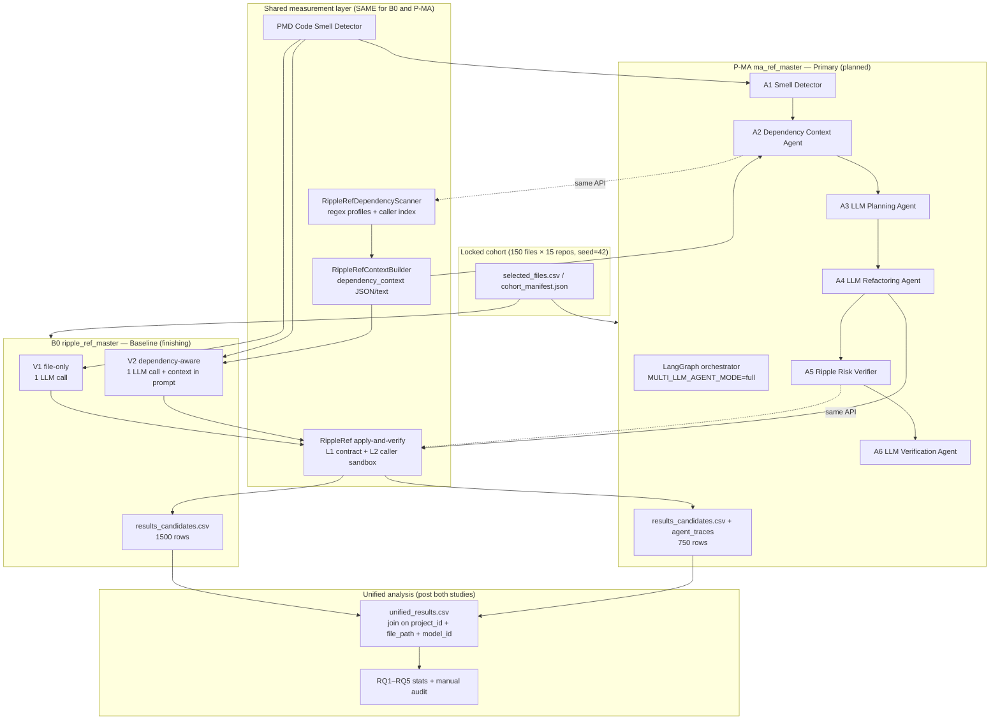

# EMSE Final Study Plan — RIPPLE-REF + Multi-Agent (`ma_ref_master`)

**Status:** B0 (`ripple_ref_master`) **not complete** — 6 ArgoUML candidates remaining (resume running)  
**Date:** 2026-07-04

---

## B0 status (now)

| Metric | Value |
|--------|-------|
| Accounted | **1,494 / 1,500** (1,176 ok + 318 fail) |
| Missing (never run) | **6** — all ArgoUML `MyTokenizer.java` |
| Systems at 100/100 | **14 / 15** |
| Blocker | System 3 ArgoUML only |

**Action:** `SYSTEM_NUM=3 RUN=1 SKIP_SETUP=1` — log: `.run/ripple-ref-argouml-final.log`

When B0 = 1500/1500 → **Phase 1 complete** → export cohort → start MA.

---

## Overall architecture



---

## Controlled experiment design

| Dimension | B0-V1 | B0-V2 | P-MA |
|-----------|-------|-------|------|
| Files | 150 | 150 | **Same 150** |
| Models | 5 | 5 | **Same 5** |
| Smells | PMD | PMD | PMD (A1) |
| Dependencies | — | **Same scanner** | **Same scanner** (A2) |
| Orchestration | 1 LLM call | 1 LLM call | **6 agents + LangGraph** |
| Ripple verify | L1–L2 | L1–L2 | **Same L1–L2** (A5) |
| Runs | 750 | 750 | 750 |
| Role in paper | Ablation | **RQ2 baseline** | **RQ3 primary** |

**Independent variable (RQ3):** orchestration only.  
**Dependent variables:** `risk_level`, `observed_broken_caller_count`, `adoption_class`, smells after.

---

## Five RQs (locked)

| RQ | Question | Data |
|----|----------|------|
| **RQ1** | Pre-refactor dependency exposure? | Profiles + A2 / dependency_contexts |
| **RQ2** | Risks from dependency-aware single-prompt? | B0-V2 |
| **RQ3** | Does multi-agent reduce ripple risk vs B0-V2? | P-MA vs B0-V2 paired |
| **RQ4** | Model differences across orchestrations? | Both × 5 models |
| **RQ5** | Factors linked to high ripple risk? | Unified regression + manual audit |

---

## Phase roadmap

### Phase 1 — Close B0 *(in progress)*
- [ ] ArgoUML 6 missing → 1500/1500
- [ ] Completeness report + freeze `ripple_ref_master`
- [ ] Export `shared_cohort/cohort_manifest.json`

### Phase 2 — Integrity documentation *(1–2 days)*
- [ ] `methods_measurement.md` — PMD version, scanner rules, L1–L2 definitions
- [ ] `threats_to_validity.md` — regex limits, manual audit plan
- [ ] Manual audit template (15 files)

### Phase 3 — MA implementation *(3–5 days)*
- [ ] A2 `dependency_context.py` — wrapper → same backend as B0
- [ ] A5 `ripple_verify.py` — wrapper → same `apply-and-verify`
- [ ] Extend A3/A6 prompts (dependency + ripple report)
- [ ] `MA_STUDY_MODE=ripple_cohort` in LangGraph
- [ ] Import cohort to research-sample per workspace

### Phase 4 — MA pilot *(1 day)*
- [ ] 10 JUnit files × 1 model
- [ ] Verify: dependency context hash(B0) == hash(MA)
- [ ] Verify: `agent_traces/` complete for 6 headline agents

### Phase 5 — MA full study *(1–2 weeks compute)*
- [ ] `ma_ref_master` — 750 runs, 15 systems sequential
- [ ] Tracker + same ripple CSV schema + `orchestration=multi_agent`

### Phase 6 — Analysis & replication *(2 weeks)*
- [ ] `unified_results.csv`
- [ ] RQ1–RQ5 statistics
- [ ] Manual audit (15 files)
- [ ] Replication package (cohort, scripts, artefacts)

---

## Integrity & transparency commitments

1. **Same tools** — PMD, `RippleRefDependencyScanner`, `apply-and-verify` for both arms  
2. **No re-sampling** — cohort locked from B0 `selectedByRepo`  
3. **State limitations** — dependencies are regex-based, not JDT/points-to  
4. **L2 empirical check** — sandbox caller breakage on both arms  
5. **Manual audit** — 15 files, agreement % reported  
6. **Full artefacts** — prompts, profiles, ripple_reports, agent_traces, CSV row even on failure  
7. **Honest labels** — B0 is single-prompt; P-MA is multi-agent; never conflate  

---

## Multi-agent pipeline (detail)

```
S1 File Loader
 → A1 Code Smell Detector        [PMD]
 → A2 Dependency Context Agent   [same scanner as B0-V2]
 → S2 Rule Planner
 → A3 LLM Planning Agent
 → S3 Size Advisor
 → A4 LLM Refactoring Agent
 → S4 Quality Verifier
 → A5 Ripple Risk Verifier       [same L1–L2 as B0]
 → A6 LLM Verification Agent
 → S5 Analysis Reporter
```

---

## Deliverables checklist

| Deliverable | Study |
|-------------|--------|
| `results_candidates.csv` | B0 + MA |
| `dependency_contexts/` | B0 (+ MA via A2) |
| `ripple_reports/` | Both |
| `agent_traces/` | MA only |
| `cohort_manifest.json` | Shared |
| `unified_results.csv` | Analysis |
| EMSE paper tables | RQ1–RQ5 |

---

## References in repo

- RQs: `.run/EMSE_Research_Questions.md`
- MA agents: `wiki/EMSE_Multi_Agent_Architecture.md`
- Integrity: `RIPPLE_REF_RESEARCH_INTEGRITY.md`
- MA implementation: `.run/ma-ref-master-plan.md`, `.run/ma-multi-agent-design.md`
