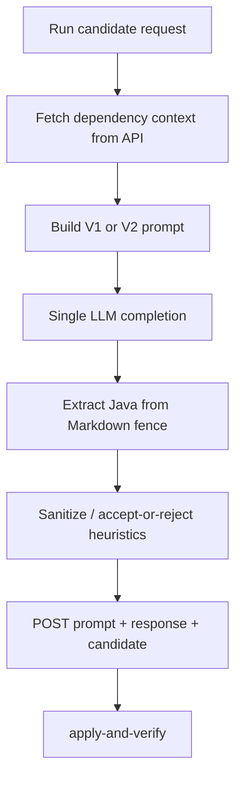
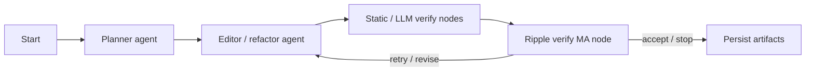

# Agentic systems

RippleREF supports two generation conditions that share the **same** verification backend.

## 1. Single-prompt (B0) — dependency-aware

**Runner:** `agents/ripple_ref_study.py`

| Variant | Idea |
|---------|------|
| `V1` | Ablation — lighter / less dependency packaging (see integrity docs) |
| `V2` | Primary — user prompt includes **dependency context package** + smells + full file |

Flow:



Important knobs:

- `RIPPLE_REF_MAX_OUTPUT_TOKENS` (default **2500**)  
- Model IDs via OpenRouter slugs in `.env` / study config  
- Sanitizer line-ratio and type-token checks (see technical setup) — truncated output can still be accepted historically; treat verification carefully  

## 2. Multi-agent (P-MA) — LangGraph

**Runner:** `agents/ma_ref_study.py`  
**Graph:** `agents/refactor_graph.py`  
**Nodes:** `agents/refactor_nodes/` (`llm_plan`, edit path, `llm_verify`, `ripple_verify_ma`, …)  
**Registry:** `agents/agent_registry.py`



Typical configuration:

- `MULTI_LLM_AGENT_MODE=full`  
- `REFACTOR_ORCHESTRATOR=langgraph`  
- Graph version recorded on result rows (`graph_version`)  

MA uses the **same** PMD smell detector and dependency scanner data as B0-V2 for fair comparison, and the **same** apply-and-verify ripple path. Study mode emphasizes sandbox / artifact persistence rather than writing into live production trees.

## Prompting surface

- `agents/llm_prompts.py` — shared prompt builders  
- B0 V2 embeds `DEPENDENCY CONTEXT PACKAGE` text from the API  
- MA agents receive structured state (file, smells, context, prior feedback)

## Providers

Default routing is **OpenRouter**. Configure:

```text
OPENROUTER_API_KEY=...
OPENROUTER_MODEL_*=provider/model-slug
LLM_ROUTING=openrouter
```

Pin exact model slugs for any scientific claim; availability changes over time.
