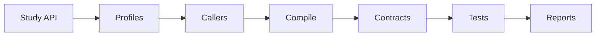
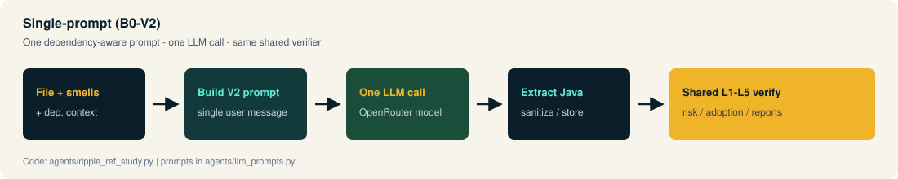
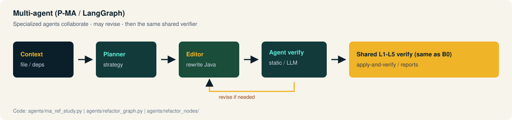

# Architecture

## Big picture (read left → right)

<p align="center">
  
</p>

| Stage | Components | Job |
|-------|------------|-----|
| **Control** | Next.js UI, batch scripts | Configure studies, launch runs |
| **Generate** | Python agents, LangGraph, OpenRouter | Produce candidates (B0 or MA) |
| **Verify** | Spring Boot API (`:8083`), L1–L5 | Score ripple / risk for every candidate |
| **Evidence** | `ripple_study_runs/…` | Persist prompts, code, profiles, reports |

Same verify path for both generation modes → fair comparisons.

## Component map

| Component | Tech | Responsibility |
|-----------|------|----------------|
| Web UI | Next.js / React | Study panels, progress, results |
| Study API | Spring Boot | Scan, select, context, verify, artifacts |
| Agents | Python + LangGraph | LLM generation (B0 and MA) |
| Scripts | Bash / Python | Overnight / pipeline automation |
| Workspaces | Filesystem | Subject repos + study artifacts |

## Backend verify chain



Profiling on the study path is **regex / textual** (not JavaParser/JDT). Smell eligibility may use **PMD**. See `docs/RIPPLE_REF_TECHNICAL_SETUP.md`.

## Artifacts (per study)

```text
ripple_study_runs/<study_id>/
  results_candidates.csv | .json
  prompts/  model_responses/  generated_candidates/
  before_profiles/  after_profiles/
  ripple_reports/  behavioral_reports/
  dependency_contexts/  diffs/  agent_traces/  ...
```

```text
pair_key = project_id | file_path | model_id | variant
```

## B0 vs MA (same landing zone)

See the dedicated flows in [Agentic systems](Agentic-Systems.md):

- [Single-prompt V2](../docs/assets/flow-single-prompt.svg)  
- [Multi-agent LangGraph](../docs/assets/flow-multi-agent.svg)  

<p align="center">
  
</p>
<p align="center">
  
</p>

## Web UI entry points

- Dashboard: **RIPPLE-REF Study**, **Multi-Agent Study**  
- Panels: `RippleRefStudyPanel`, `MaRefStudyPanel`, results + L5 views  
