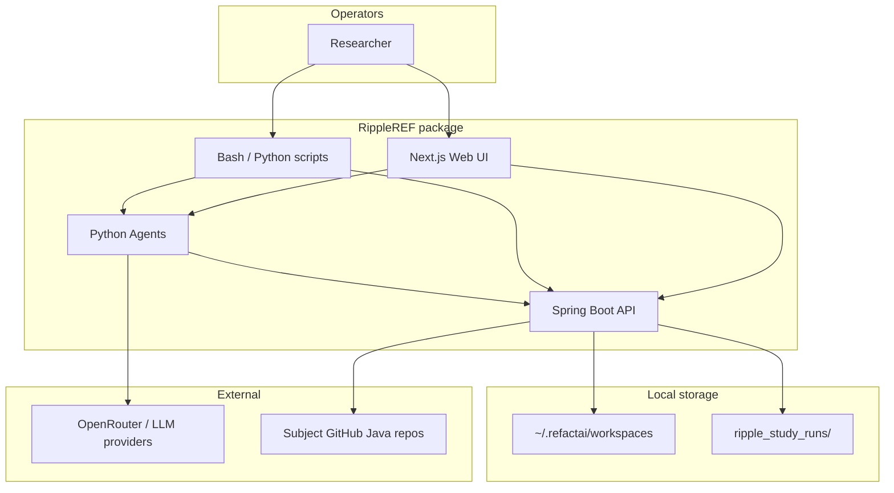
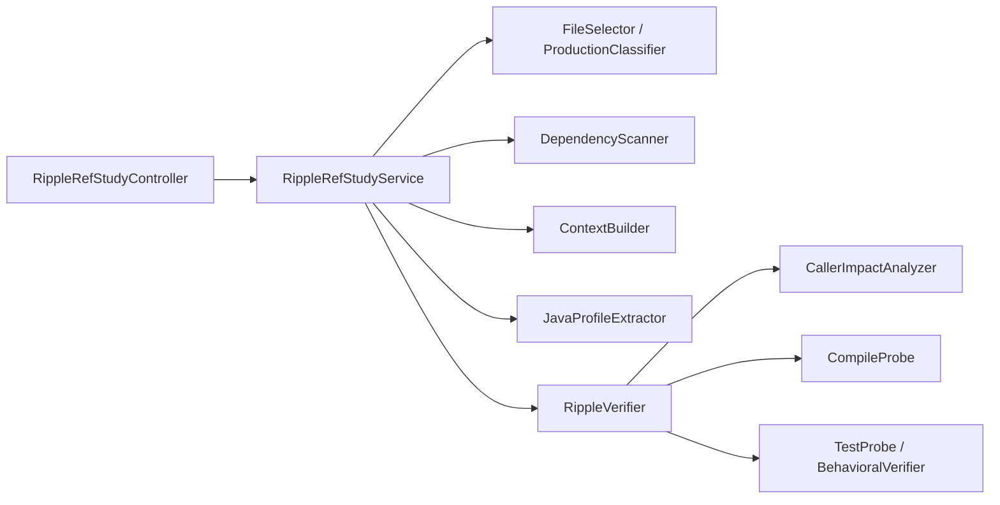
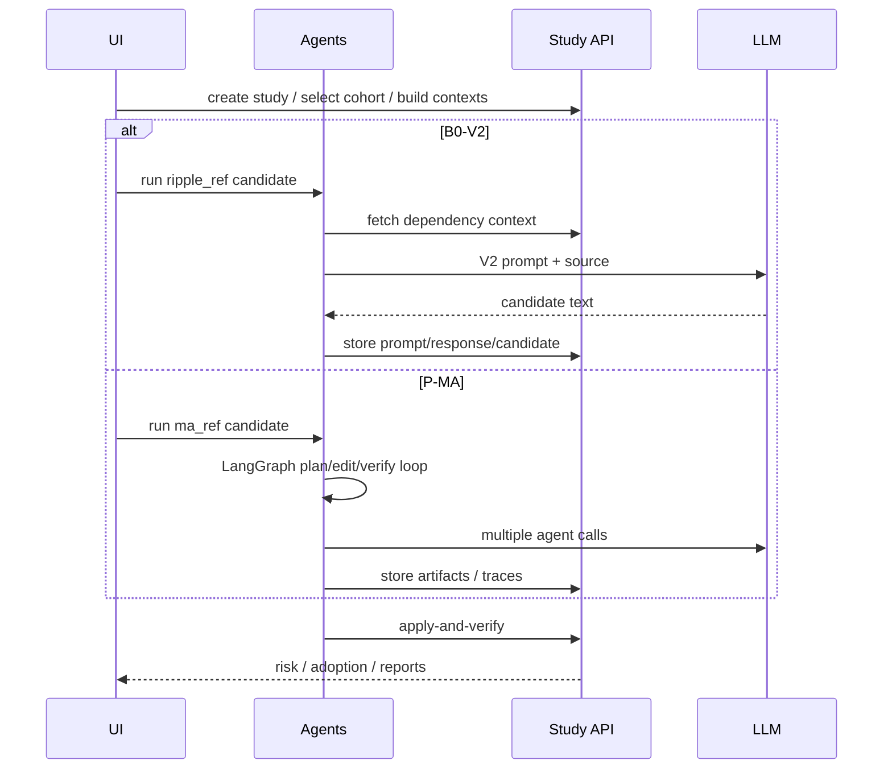

# Architecture

## System context



## Component map

| Component | Tech | Responsibility |
|-----------|------|----------------|
| Web UI | Next.js / React | Study configuration, progress, results tables, MA pipeline view |
| Study API | Spring Boot | Repo scan, file selection, dependency context, verify, artifact I/O |
| Agents | Python + LangGraph | LLM generation (B0 and MA) |
| Scripts | Bash/Python | Batch overnight runs, backfills, exports |
| Workspaces | Filesystem | Cloned repos + per-candidate artifacts |

## Backend ripple package



Profiling is **regex / textual** (not JavaParser/JDT on the study path). Smell eligibility may use **PMD**. See `docs/RIPPLE_REF_TECHNICAL_SETUP.md`.

## Artifact layout (per study)

```text
ripple_study_runs/<study_id>/
  results_candidates.csv
  results_candidates.json
  prompts/
  model_responses/
  generated_candidates/
  before_profiles/  after_profiles/
  ripple_reports/   behavioral_reports/
  dependency_contexts/
  diffs/  original_files/  agent_traces/  ...
```

Identity key:

```text
pair_key = project_id | file_path | model_id | variant
```

## Single-prompt vs multi-agent path



## Web UI entry points

- Dashboard nav: **RIPPLE-REF Study**, **Multi-Agent Study**  
- Panels: `RippleRefStudyPanel`, `MaRefStudyPanel`, results tables, L5 pipeline panels  
