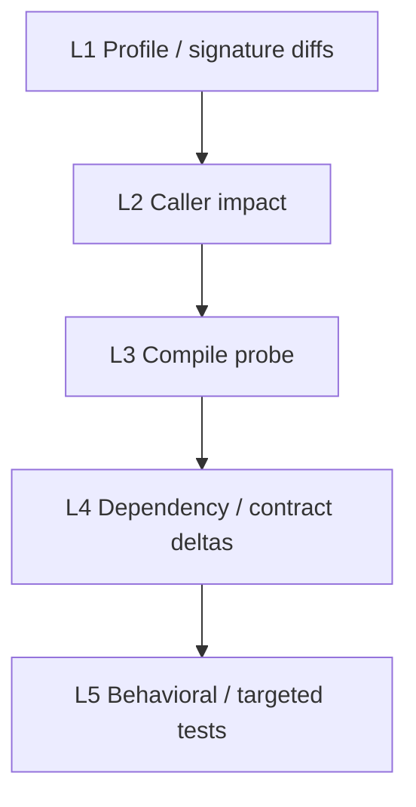

# Experiment protocol

This page summarizes how RippleREF was used for a **repository-level ripple** study. Adapt numbers and models for your own replication.

## Research questions (typical)

1. **RQ1** — Dependency / contract exposure before refactoring  
2. **RQ2** — Ripple risks from dependency-aware single-prompt refactoring  
3. **RQ3** — Does multi-agent orchestration reduce ripple risk vs B0-V2?  
4. **RQ4** — Model-specific ripple behaviour  
5. **RQ5** — Factors associated with high ripple risk  

Authoritative text snapshots: `docs/paper/Research_Questions.md`.

## Cohort (example locked design)

| Parameter | Example value |
|-----------|----------------|
| Systems | 15 open-source Java projects |
| Files | 10 per system → **150** files |
| Sampling | Stratified, seed **42** |
| Models | 5 frontier models via OpenRouter |
| Primary contrast | P-MA vs B0-V2 on `(project, file, model)` |

MA imports the **same** `(project_id, file_path)` pairs from B0 (`cohort_manifest`) — no re-sampling.

## Verification levels (L1–L5)

| Level | Meaning |
|-------|---------|
| L1 | Before/after Java profiles (APIs, inheritance, package, …) |
| L2 | Downstream callers still resolve caller-used APIs |
| L3 | Module compile probe |
| L4 | Dependency / fan-out style deltas and related contract signals |
| L5 | Test / behavioral probe when eligible |

Risk and adoption labels are produced by the verifier (`risk_level`, `adoption_class`). Paper taxonomies (e.g. UNSAFE) may map from these fields — see integrity docs.

## Generation limits

- Default max completion tokens: **`RIPPLE_REF_MAX_OUTPUT_TOKENS=2500`**  
- Truncated model output is a known failure mode; do not treat historical `completed` as proof of a valid compilation unit without checks  

## Integrity references

- `docs/RIPPLE_REF_RESEARCH_INTEGRITY.md`  
- `docs/MA_RESEARCH_INTEGRITY.md`  
- `wiki/EMSE_Experimental_Setting.md`  
- `wiki/Research_Cohort_Inclusion_Flow.md`  
