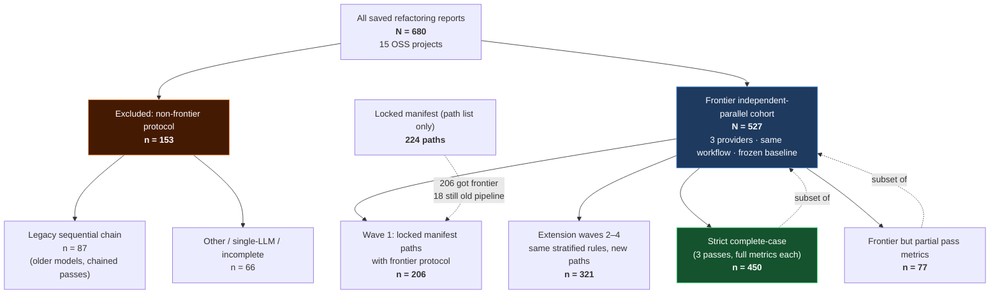

# Research cohort inclusion flow (680 → 527 → 450)

One-page audit of how evaluation files were selected. Counts from disk audit of `~/.refactai/workspaces` (June 2026).

**Use for:** Methods / Threats justification — why **527** is the main cohort and why not 680, 224, or 150.

---

## Inclusion flow (main figure)



---

## ASCII summary (copy-paste friendly)

```
680  all saved reports (15 projects)
 │
 ├─ 153  EXCLUDED (wrong protocol for RQ2/RQ3 primary)
 │    ├─  87  legacy sequential multi-LLM chain
 │    └─  66  other / single-LLM / incomplete pipeline
 │
 └─ 527  PRIMARY FRONTIER COHORT  ← main evaluation set
      ├─ 206  wave-1 manifest paths (frontier complete)
      ├─ 321  extension batch waves (same protocol, new paths)
      │
      ├─ 450  complete-case (all 3 passes, full metric sections)
      └─  77  frontier runs with partial pass-level metrics

224  locked manifest paths (wave-1 participant list; not all re-run on frontier)
     ├─ 206  frontier protocol applied
     └─  18   manifest paths still on non-frontier pipeline
```

---

## Count table (paper-ready)

| Stage | Files | Provider pass rows | Role |
|-------|------:|-------------------:|------|
| All saved on disk | **680** | — | Upper bound (includes pilots & legacy) |
| Excluded (non-frontier) | **153** | — | Sensitivity only; do not pool with 527 |
| **Primary frontier cohort** | **527** | **1,581** | **Main RQ2 / RQ3 analysis** |
| ↳ Wave 1 (manifest ∩ frontier) | 206 | 618 | Pre-registered path list |
| ↳ Extension waves 2–4 | 321 | 963 | Same protocol, excluded prior paths |
| Complete-case (full pass metrics) | **450** | **1,350** | Strict metric battery / balanced stats |
| Partial pass metrics (within 527) | 77 | 231 | Use for acceptance/smells; flag missing secondary metrics |

---

## Why 527 (not another number)

| Alternative N | Why it is not the primary cohort |
|---------------|----------------------------------|
| **150** | Outdated design text (10×15); not what was executed |
| **224** | Manifest path list only; 18 never got frontier protocol |
| **206** | Manifest ∩ frontier only; drops 321 extension files you completed |
| **450** | Valid **complete-case** subset of 527, not the full executed set |
| **680** | Mixes 153 files under a **different experiment** (legacy chain, etc.) |
| **527** | **Exhaustive** set of files that finished frontier independent-parallel execution |

527 was **not** chosen as a target. It is the count of unique files that completed the final protocol after repeated **≤15-file stratified batches** per project (1–4 waves depending on project pool and run completion).

---

## Per-project frontier totals (527 breakdown)

| Project | Frontier files | Batch waves (≈15 each) |
|---------|---------------:|------------------------|
| 01-Johotdraw | 60 | 4 |
| 02-GanttProject-master | 45 | 3 |
| 09-Logback.zip | 40 | 3 |
| 14-Checkstyle | 44 | 3 |
| 10-Mockito | 41 | 3 |
| 03, 07, 11, 12, 13 | 30 each | 2 |
| 05, 06, 08 | 29 each | 2 (partial last wave) |
| 04-Xerces-j-main | 26 | 2 (13+13) |
| 15-JabRef | 34 | 3 (last wave partial: 4) |
| **Total** | **527** | **38 sample batches** |

---

## Protocol inclusion rule (527)

A file is in the **527 frontier cohort** if its saved report has:

1. `multiLlmMode = independent_parallel`
2. Three provider passes (OpenAI, Google, Anthropic)
3. Same multi-agent workflow and frozen baseline snapshot

**Excluded (153)** = saved but failing (1) — typically legacy chain or incomplete runs.

---

## Suggested paper uses

| Analysis | Cohort | Sheets (Excel export) |
|----------|--------|------------------------|
| Main RQ2 / RQ3 | 527 frontier | `32`, `26`, `28`, `01` |
| Complete-case sensitivity | 450 | `38`, `39`, `40` |
| Manifest-only sensitivity | 206 | `24`, `30`, `34` |
| Legacy protocol comparison | 87 chain vs 527 | `27` (label as different experiment) |

See also: `wiki/Research_Excel_Sheet_Reference.md`, `wiki/ICSE_Research_Questions.tex`.

*Counts verified via `scripts/audit-research-integrity.sh` and disk inventory, June 2026.*
